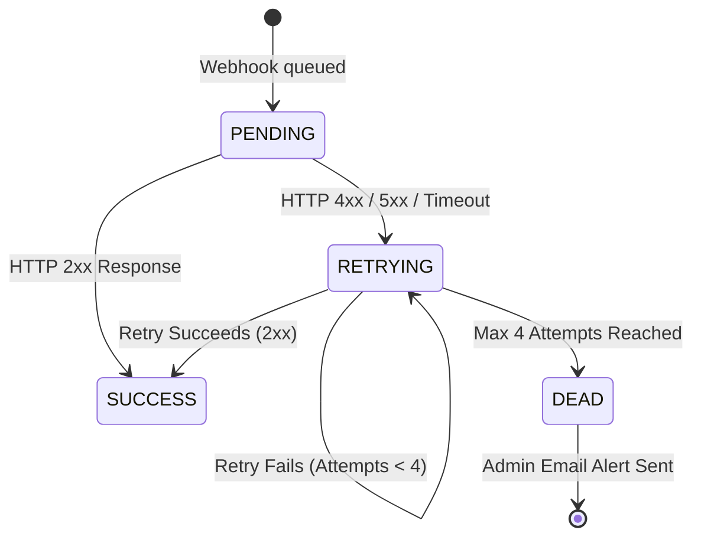

# Shipment Tracking Webhook Integration Guide

This document describes the webhook interface provided by the Shipment Tracking Service. External systems can consume these webhooks to receive real-time notifications whenever a shipment's tracking status changes.

---

## 1. Webhook Interface Specifications

The service notifies receiving systems via standard HTTP `POST` requests.

### 1.1 HTTP Request Details

| Property | Value / Description |
| :--- | :--- |
| **HTTP Method** | `POST` |
| **Content-Type** | `application/json` |
| **Timeout** | 10 seconds |
| **Delivery Model** | At-least-once delivery |

### 1.2 Expected Response

Your webhook receiver endpoint must respond with:
* **HTTP Status Code**: Any `2xx` status code (e.g., `200 OK` or `204 No Content`).
* **Response Time**: Within 3 seconds (recommended) to prevent timeout triggers.
* Any response code outside `200`–`299` (or a connection timeout) is treated as a delivery failure and will trigger automatic retries.

---

## 2. Webhook Event Types

| Event Name | Description | Trigger Condition |
| :--- | :--- | :--- |
| `shipment.status.updated` | Dispatched when a shipment's lifecycle status changes. | Occurs whenever a newly detected carrier status differs from the previous recorded status. |

---

## 3. Payload Structure

### 3.1 JSON Schema

```json
{
  "eventId": "651f8a7e3b8a1c001f9d2a34",
  "event": "shipment.status.updated",
  "data": {
    "referenceNumber": "PO-25898-1",
    "trackingNumber": "9434616904205611895069",
    "status": "delivered",
    "courier": "USPS",
    "lineItems": [
      {
        "lineNo": 1,
        "itemCode": "2Y91602",
        "description": "20-30 MV HARMONY SL GLOVE JAVA II",
        "qtyOrdered": 3,
        "qtyShipped": 3,
        "BO": 0
      },
      {
        "lineNo": 2,
        "itemCode": "2Y01602",
        "description": "20-30 MV HARMONY ARMSLEEVE TB JAVA II",
        "qtyOrdered": 3,
        "qtyShipped": 3,
        "BO": 0
      }
    ]
  }
}
```

### 3.2 Field Definitions

#### Root Object

| Field | Type | Required | Description |
| :--- | :--- | :--- | :--- |
| `eventId` | `string` | Yes | Unique identifier for the event. Used for deduplication and idempotency checks. |
| `event` | `string` | Yes | The event name (e.g., `shipment.status.updated`). |
| `data` | `object` | Yes | Object containing the updated shipment information. |

#### Data Object (`data`)

| Field | Type | Required | Description |
| :--- | :--- | :--- | :--- |
| `referenceNumber` | `string` | Yes | The purchase order or reference identifier associated with the order (`poNumber`). |
| `trackingNumber` | `string` | Yes | The parcel tracking number assigned by the courier. |
| `status` | `string` | Yes | The normalized shipment status string (lowercase). |
| `courier` | `string` | Yes | Carrier name (e.g., `USPS`, `FEDEX`, `UPS`). |
| `lineItems` | `array` | Yes | Array of line item objects associated with the shipment order. |

#### Line Item Object (`data.lineItems[]`)

| Field | Type | Required | Description |
| :--- | :--- | :--- | :--- |
| `lineNo` | `number` / `null` | Yes | Order line item index / line number (e.g., `1`, `2`). |
| `itemCode` | `string` | Yes | SKU / item product code. |
| `description` | `string` | Yes | Description or name of the item. |
| `qtyOrdered` | `number` | Yes | Total quantity ordered. |
| `qtyShipped` | `number` | Yes | Quantity shipped in this parcel. |
| `BO` | `number` | Yes | Backordered quantity remaining. |

---

## 4. Shipment Statuses & Lifecycle

Shipments transition through standardized lifecycle statuses:

| Status | Type | Description |
| :--- | :--- | :--- |
| `pending` | Active | Initial registration; awaiting carrier pickup or first scan. |
| `accepted` | Active | Package accepted or picked up by carrier. |
| `in_transit` | Active | Package is moving within the carrier distribution network. |
| `out_for_delivery` | Active | Package is out with the local driver for final delivery. |
| `delivered` | **Terminal** | Package successfully delivered to destination. |
| `exception` | Active | Carrier exception occurred (e.g., delay, address issue, customs). |
| `cancelled` | **Terminal** | Shipment or tracking was cancelled. |
| `returned` | **Terminal** | Package returned to sender. |
| `lost` | **Terminal** | Package declared lost by courier. |
| `invalid` | **Terminal** | Tracking number is rejected or invalid. |

> [!NOTE]
> **Terminal Statuses**: Once a shipment reaches a terminal status (`delivered`, `cancelled`, `returned`, `lost`, or `invalid`), tracking is complete and no further webhook events will be sent for that tracking number.

---

## 5. Delivery & Retry Policy

To guarantee event delivery over unreliable networks, the service follows an automated retry policy:

### 5.1 Lifecycle Delivery States



### 5.2 Retry Schedule & Dead-Letter Alerts

* **Total Attempts**: Up to **4 attempts** per event.
* **Retry Schedule**:
  1. **Attempt 1**: Immediate dispatch upon status update (`agenda.now("send-webhook")`).
  2. **Attempt 2**: **5 seconds** after Attempt 1 failure.
  3. **Attempt 3**: **10 seconds** after Attempt 2 failure.
  4. **Attempt 4**: **15 minutes** after Attempt 3 failure.
* **Failure Criteria**: Any HTTP response code other than `2xx` (`4xx`, `5xx`), network error, or request timeout (>10s).
* **Dead-Letter Email Notification**: If all 4 attempts fail, the delivery status is marked as **`DEAD`** and an automated email alert is sent to administrators via `SendEmail(event, errorMessage)` with the failure details and payload.

---

## 6. Integration Guide for Consumers

To build an integration for consuming this webhook interface, follow these core practices:

### 1. Route by Event Type
Inspect the `event` field in incoming payloads to route requests to the appropriate handler (e.g., `shipment.status.updated`). Ignore or log unknown event types for forward compatibility.

### 2. Implement Idempotency (Deduplication)
Due to network timeouts or retries, duplicate deliveries can happen. Store the `eventId` of processed events and check for its presence before performing any business logic or mutations.

### 3. Acknowledge Fast
Always return an HTTP `2xx` (`200 OK` or `204 No Content`) response immediately after basic payload validation. Any heavy processing, external API calls, or notification workflows should be executed asynchronously to prevent exceeding the 10-second timeout window.

### 4. Status Code Handling
* Return `2xx` to signal successful receipt and stop further retries.
* Return `5xx` only if your service is encountering a transient error and needs the webhook service to retry delivery.
